<p align="center">
  
</p>

<p align="center">
  <a href="https://www.linkedin.com/in/golam-misba-uddin-sekh/"></a>
  <a href="mailto:misbaseikh27@gmail.com"></a>
  
  
</p>

<p align="center">
  
</p>

---

### 👨‍💻 About me

```ts
const misba = {
  role: "Frontend Developer",
  experience: "2.5+ years · 50+ live client projects",
  domains: ["Healthcare SaaS", "ERP", "Event booking", "E-commerce"],
  clients: ["India", "Australia", "New Zealand", "UAE"],
  focus: "Clean, fast, easy-to-use screens for real businesses",
  exploring: ["AI features with Gemini & Claude APIs", "Full-stack"],
  available: "Immediately",
};
```

---

### 🛠 Tech stack

<p align="left">
  
  <br/>
  
</p>

| Area | What I use |
|---|---|
| **Web** | React.js, Next.js, Astro, Vite, PWA |
| **Mobile** | React Native, Ionic, Capacitor, Android Studio, Xcode |
| **State & data** | Redux Toolkit, Zustand, TanStack Query, REST APIs, Axios, Socket.io |
| **UI & motion** | Tailwind CSS, Material UI, Ant Design, Bootstrap, SASS, GSAP, Framer Motion, Lenis, Three.js |
| **Services** | Firebase, Razorpay, Gemini API |

---

### 🚀 Projects I've built

> Client code is private, so here is what each project does and what I built.

<table>
<tr>
<td width="50%" valign="top">

**🏥 Hospital Feedback & Complaint SaaS**<br/>
Multi-hospital web app, admin panel and mobile app for OPD, IPD, staff and consultant feedback. Live ticket status with Socket.io, push notifications, and an AI weekly summary (tested with the Gemini API).<br/>
`React` `Vite` `Redux` `Socket.io` `Firebase`

</td>
<td width="50%" valign="top">

**🎟 Event Pass Booking Platform**<br/>
Online Navratri pass booking with OTP login, Razorpay payments, QR passes with PDF download, and an admin panel for scan entry, refunds and reports.<br/>
`React` `Ionic` `Capacitor` `Razorpay` `Firebase`

</td>
</tr>
<tr>
<td width="50%" valign="top">

**💍 Jewellery E-commerce Platform**<br/>
Online store with wishlist, cart, coupons and Razorpay checkout, an admin panel, and a React Native billing app for the shop counter.<br/>
`React` `Ionic` `React Native` `TypeScript` `TanStack Query`

</td>
<td width="50%" valign="top">

**🏭 Industrial ERP Software**<br/>
Factory admin panel and mobile app for stock in/out, workers, production reports and delivery tracking.<br/>
`Ionic` `React Native` `TypeScript` `Zustand` `TanStack Query`

</td>
</tr>
<tr>
<td width="50%" valign="top">

**🦷 Dental Hospital Management Software**<br/>
Appointment booking, doctor scheduling and patient-record screens, with separate versions for Australia, New Zealand and the UAE.<br/>
`React` `Vite` `REST APIs`

</td>
<td width="50%" valign="top">

**🎮 Indoor Entertainment Centre Platform**<br/>
Animated website, admin panel for games, offers and café, and a customer app with wallet, rewards and QR entry.<br/>
`React` `Tailwind` `GSAP` `Ionic` `React Native`

</td>
</tr>
</table>

---

### 📊 GitHub activity

<p align="center">
  
</p>

<p align="center">
  
</p>

---

<p align="center">
  <b>Looking for a frontend developer who ships?</b> Let's talk on <a href="https://www.linkedin.com/in/golam-misba-uddin-sekh/">LinkedIn</a> or at <a href="mailto:misbaseikh27@gmail.com">misbaseikh27@gmail.com</a>.
</p>
